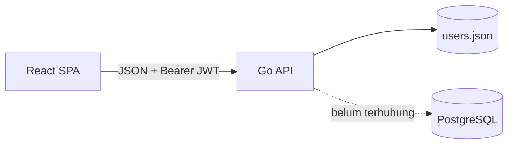

<div align="center">

# UNESARENT

Starter monorepo autentikasi fullstack dengan React, Go, JWT, dan PostgreSQL.

[](https://go.dev/)
[](https://react.dev/)
[](https://vite.dev/)
[](https://www.postgresql.org/)
[](https://jwt.io/)

[Fitur](#fitur) · [Arsitektur](#arsitektur) · [Quick Start](#quick-start) · [API](#api-reference) · [Dokumentasi](#dokumentasi)

</div>

---

## Tentang Proyek

UNESARENT adalah fondasi aplikasi fullstack yang berfokus pada autentikasi. Backend Go
menyediakan register, login, dan endpoint profil dengan access token JWT. Frontend React
sudah memiliki seluruh state autentikasi, pemanggilan API, penyimpanan token, dan guard
halaman — tampilan sengaja dibuat minimal agar bebas dikustomisasi.

Setup PostgreSQL juga sudah disiapkan di direktori [`postgres/`](postgres/README.md),
tetapi **belum terhubung** ke backend. Backend saat ini menggunakan penyimpanan JSON
untuk development.

> **Status proyek:** logika autentikasi siap dipakai. Halaman UI di `frontend/src/App.jsx`
> masih berupa placeholder.

---

## Fitur

### Autentikasi

- Register dengan validasi nama, email, dan password
- Login dengan verifikasi password bcrypt
- Access token JWT HS256 dengan masa berlaku yang dapat dikonfigurasi
- Endpoint `GET /api/auth/me` untuk mengambil user yang sedang login
- Register otomatis login
- Pemulihan sesi setelah refresh halaman
- Logout client-side
- Pesan error generik untuk mencegah user enumeration
- Error validasi per field untuk kebutuhan form

### Backend

- Go standard library `net/http` tanpa framework router tambahan
- Middleware CORS, logging, recovery, dan autentikasi Bearer token
- Graceful shutdown
- Request body limit 1 MB
- Penyimpanan user JSON yang aman untuk development
- Penulisan file atomik dan permission `0600`

### Frontend

- `AuthProvider` dan hook `useAuth()`
- `RequireAuth` untuk memproteksi halaman
- Fetch wrapper dengan `ApiError` terstruktur
- Penyimpanan token di `localStorage`
- Proxy Vite untuk menghindari CORS saat development
- Build produksi dengan Vite

### Infrastruktur

- PostgreSQL 17 + Docker Compose
- Schema awal, unique index email case-insensitive, dan trigger `updated_at`
- Contoh environment untuk backend, frontend, dan database
- Makefile untuk menjalankan seluruh stack

---

## Arsitektur



Alur autentikasi:

1. Frontend mengirim kredensial ke `/api/auth/register` atau `/api/auth/login`.
2. Backend memvalidasi input, memproses password dengan bcrypt, lalu menerbitkan JWT.
3. `AuthProvider` menyimpan token dan data user.
4. Setiap request terproteksi mengirim header `Authorization: Bearer <token>`.
5. Middleware memverifikasi signature, issuer, dan masa berlaku token.
6. Endpoint `/api/auth/me` mengembalikan data user terbaru.

---

## Tech Stack

| Layer     | Teknologi                          |
| --------- | ---------------------------------- |
| Frontend  | React 19, Vite 7, JavaScript        |
| Backend   | Go 1.26+, `net/http`, `log/slog`   |
| Auth      | JWT HS256, bcrypt                  |
| Database  | PostgreSQL 17 (belum terhubung)    |
| Tooling   | Make, Docker Compose, npm          |

---

## Struktur Proyek

```text
UNESARENT/
├── backend/
│   ├── cmd/server/
│   ├── internal/
│   │   ├── auth/
│   │   ├── config/
│   │   ├── httpapi/
│   │   └── user/
│   ├── .env.example
│   ├── go.mod
│   └── README.md
├── frontend/
│   ├── src/
│   │   ├── auth/
│   │   ├── lib/
│   │   ├── App.jsx
│   │   └── main.jsx
│   ├── .env.example
│   ├── vite.config.js
│   └── README.md
├── postgres/
│   ├── initdb/
│   ├── docker-compose.yml
│   ├── .env.example
│   └── README.md
├── Makefile
└── README.md
```

Dokumentasi lebih detail tersedia di [backend/README.md](backend/README.md),
[frontend/README.md](frontend/README.md), dan [postgres/README.md](postgres/README.md).

---

## Quick Start

### Prasyarat

| Kebutuhan | Versi                                  |
| --------- | -------------------------------------- |
| Go        | 1.26+                                  |
| Node.js   | 20.19+ atau 22.12+                     |
| npm       | 10+                                    |
| Docker    | Opsional, untuk PostgreSQL             |
| Make      | Opsional, mempermudah perintah umum    |

### Instalasi

```bash
git clone <repository-url>
cd UNESARENT
make install
```

Jika tidak memakai Make:

```bash
cd backend && go mod download
cd ../frontend && npm install
```

### Konfigurasi backend

```bash
cp backend/.env.example backend/.env
openssl rand -base64 48
```

Salin hasil perintah `openssl` ke nilai `JWT_SECRET` di `backend/.env`.

### Menjalankan aplikasi

```bash
make dev
```

Perintah tersebut menjalankan backend dan frontend sekaligus. Alternatif dua terminal:

```bash
make backend
```

```bash
make frontend
```

| Service  | URL                     |
| -------- | ----------------------- |
| Frontend | `http://localhost:5173` |
| Backend  | `http://localhost:8080` |
| Health   | `http://localhost:8080/api/health` |

### PostgreSQL opsional

```bash
cd postgres
cp .env.example .env
docker compose up -d
```

Atau dari root:

```bash
make db-up
```

Backend belum membaca database ini. Lihat [postgres/README.md](postgres/README.md) untuk
detail schema dan rencana integrasi.

---

## Konfigurasi

### Backend

File: `backend/.env`

| Variable       | Default                     | Deskripsi                                  |
| -------------- | --------------------------- | ------------------------------------------ |
| `APP_ADDR`     | `:8080`                     | Alamat listen HTTP server                  |
| `JWT_SECRET`   | secret development          | Secret JWT, minimal 32 karakter            |
| `JWT_TTL`      | `24h`                       | Masa berlaku access token                  |
| `CORS_ORIGINS` | `http://localhost:5173,...` | Origin frontend yang diizinkan             |
| `STORE_PATH`   | `data/users.json`           | Lokasi penyimpanan user                    |

`JWT_SECRET` wajib diganti sebelum deploy. Jika kosong, backend memakai secret
development dan menampilkan peringatan saat startup.

### Frontend

File: `frontend/.env`

| Variable       | Default | Deskripsi                                      |
| -------------- | ------- | ---------------------------------------------- |
| `VITE_API_URL` | kosong  | Base URL API jika tidak memakai proxy Vite     |

Saat development biarkan kosong. Vite meneruskan `/api` ke `http://localhost:8080`.

### PostgreSQL

File: `postgres/.env`

| Variable          | Default       | Deskripsi                    |
| ----------------- | ------------- | ---------------------------- |
| `POSTGRES_USER`   | `unesarent`   | Username database            |
| `POSTGRES_PASSWORD` | `unesarent_dev` | Password database         |
| `POSTGRES_DB`     | `unesarent`   | Nama database                |
| `POSTGRES_PORT`   | `5432`        | Port host                    |
| `DATABASE_URL`    | -             | DSN untuk integrasi backend  |

---

## API Reference

Base URL development: `http://localhost:8080`

Endpoint terproteksi membutuhkan header:

```http
Authorization: Bearer <token>
```

### Ringkasan endpoint

| Method | Endpoint             | Auth   | Status sukses | Deskripsi                    |
| ------ | -------------------- | ------ | ------------- | ---------------------------- |
| GET    | `/api/health`        | Tidak  | `200`         | Health check                 |
| POST   | `/api/auth/register` | Tidak  | `201`         | Registrasi user              |
| POST   | `/api/auth/login`    | Tidak  | `200`         | Login user                   |
| GET    | `/api/auth/me`       | Ya     | `200`         | Data user yang sedang login  |

### Register

```http
POST /api/auth/register
Content-Type: application/json
```

```json
{
  "name": "Budi Santoso",
  "email": "budi@example.com",
  "password": "rahasia123"
}
```

Response `201 Created`:

```json
{
  "token": "eyJhbGciOiJIUzI1NiIs...",
  "token_type": "Bearer",
  "expires_at": "2026-11-15T11:57:02+07:00",
  "user": {
    "id": "a111cd4a97e652933cc3474a66c3ad3c",
    "name": "Budi Santoso",
    "email": "budi@example.com",
    "created_at": "2026-11-14T04:57:02Z"
  }
}
```

Aturan input:

| Field      | Aturan                                  |
| ---------- | --------------------------------------- |
| `name`     | 2–80 karakter                           |
| `email`    | Format email valid, maksimal 254 karakter |
| `password` | 8–72 byte                               |

### Login

```http
POST /api/auth/login
Content-Type: application/json
```

```json
{
  "email": "budi@example.com",
  "password": "rahasia123"
}
```

Response `200 OK` memiliki bentuk yang sama dengan register.

### Me

```http
GET /api/auth/me
Authorization: Bearer <token>
```

```json
{
  "user": {
    "id": "a111cd4a97e652933cc3474a66c3ad3c",
    "name": "Budi Santoso",
    "email": "budi@example.com",
    "created_at": "2026-11-14T04:57:02Z"
  }
}
```

### Format error

```json
{
  "error": {
    "code": "validation_error",
    "message": "Data yang dikirim tidak valid",
    "fields": {
      "email": "Format email tidak valid",
      "password": "Password minimal 8 karakter"
    }
  }
}
```

| Code                  | HTTP | Deskripsi                              |
| --------------------- | ---- | -------------------------------------- |
| `validation_error`    | 422  | Input tidak valid, lihat `fields`      |
| `email_taken`         | 409  | Email sudah terdaftar                  |
| `invalid_credentials` | 401  | Email atau password salah              |
| `missing_token`       | 401  | Header Authorization tidak ada         |
| `invalid_token`       | 401  | Token tidak valid                      |
| `token_expired`       | 401  | Token sudah kedaluwarsa                |
| `user_not_found`      | 401  | User dari token tidak ditemukan        |
| `invalid_body`        | 400  | Body bukan JSON yang valid             |
| `internal_error`      | 500  | Kesalahan internal server              |

Body register dan login memakai `DisallowUnknownFields`. Kirim hanya field yang
terdaftar dan jangan menyertakan field tambahan seperti `confirmPassword`.

---

## Integrasi Frontend

Seluruh state autentikasi tersedia melalui `useAuth()`.

```jsx
import { useAuth } from './auth/useAuth'

const { user, status, error, pending, login, register, logout } = useAuth()
```

| Properti          | Tipe                        | Deskripsi                              |
| ----------------- | --------------------------- | -------------------------------------- |
| `user`            | `object \| null`            | User yang sedang login                 |
| `status`          | `string`                    | `loading`, `anonymous`, `authenticated` |
| `error`           | `ApiError \| null`          | Error terakhir                         |
| `pending`         | `boolean`                   | Proses login/register berjalan         |
| `isAuthenticated` | `boolean`                   | Status autentikasi                     |
| `login`           | `function`                  | `login({ email, password })`           |
| `register`        | `function`                  | `register({ name, email, password })`  |
| `logout`          | `function`                  | Menghapus sesi client-side             |
| `clearError`      | `function`                  | Menghapus error terakhir               |

Contoh halaman login:

```jsx
import { useState } from 'react'
import { useAuth } from './auth/useAuth'

export default function LoginPage() {
  const { login, pending, error } = useAuth()
  const [form, setForm] = useState({ email: '', password: '' })

  async function handleSubmit(event) {
    event.preventDefault()
    try {
      await login(form)
    } catch (err) {
      console.error(err)
    }
  }

  return (
    <form onSubmit={handleSubmit}>
      <input
        type="email"
        value={form.email}
        onChange={(event) => setForm({ ...form, email: event.target.value })}
        required
      />
      <input
        type="password"
        value={form.password}
        onChange={(event) => setForm({ ...form, password: event.target.value })}
        required
      />
      {error && <p>{error.message}</p>}
      {error?.fields?.email && <p>{error.fields.email}</p>}
      {error?.fields?.password && <p>{error.fields.password}</p>}
      <button disabled={pending}>{pending ? 'Memproses...' : 'Login'}</button>
    </form>
  )
}
```

Guard halaman:

```jsx
import { RequireAuth } from './auth/RequireAuth'

<RequireAuth fallback={<LoginPage />}>
  <Dashboard />
</RequireAuth>
```

Request ke endpoint lain:

```js
import { request } from './lib/http'

const data = await request('/api/endpoint')
```

`request` otomatis menambahkan Bearer token dan melempar `ApiError` dengan properti
`status`, `code`, dan `fields`.

---

## Perintah

| Perintah        | Deskripsi                                  |
| --------------- | ------------------------------------------ |
| `make install`  | Install dependency backend dan frontend    |
| `make dev`      | Jalankan backend dan frontend              |
| `make backend`  | Jalankan backend saja                      |
| `make frontend` | Jalankan frontend saja                     |
| `make db-up`    | Jalankan PostgreSQL                        |
| `make db-down`  | Hentikan PostgreSQL                        |
| `make db-reset` | Hapus volume lalu jalankan ulang database  |

Verifikasi build:

```bash
cd backend && go build ./... && go vet ./...
cd frontend && npm run build
```

---

## Keamanan

- Password di-hash dengan bcrypt dan tidak pernah dikirim ke client.
- Login mengembalikan pesan generik untuk mengurangi user enumeration.
- JWT menggunakan algoritma HS256 dengan validasi issuer, expiry, dan signing method.
- Token disimpan di `localStorage`. Pola ini praktis, tetapi rentan jika terjadi XSS.
- Logout bersifat client-side karena JWT stateless.
- Logout server-side memerlukan refresh token, session table, atau denylist.
- Sebelum deploy, gunakan HTTPS, secret dari secret manager, CORS yang ketat, dan
  rate limiting pada endpoint autentikasi.
- Jangan commit file `.env` atau password database.

---

## Dokumentasi

| Dokumen                                | Isi                                      |
| -------------------------------------- | ---------------------------------------- |
| [backend/README.md](backend/README.md) | Arsitektur backend, konfigurasi, storage |
| [frontend/README.md](frontend/README.md) | Struktur frontend dan penggunaan auth  |
| [postgres/README.md](postgres/README.md) | Database, schema, dan integrasi         |

---


